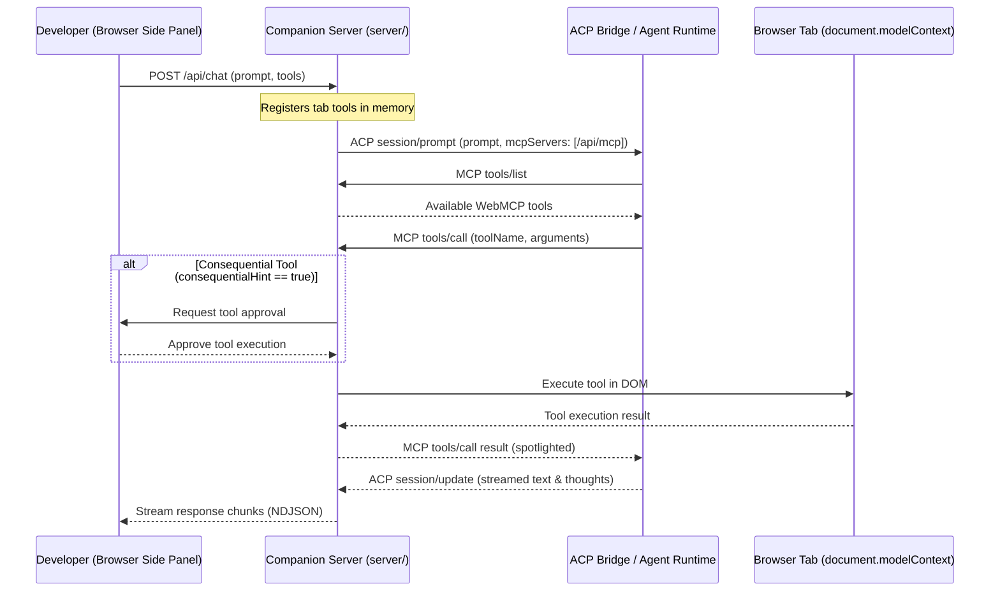

# Agent client protocol backend for companion server

* **Author:** Mike Kobit
* **Status:** Draft
* **Date:** 2026-11-10

---

## Overview

This document specifies an Agent Client Protocol (ACP) backend and an in-process Model Context Protocol (MCP) server for the `webmcp-extension` companion server (`server/`).
The companion server connects to local agent runtimes such as Google Antigravity (`agy acp`) and OpenAI Codex (`codex-acp`) through a local socket or stdio bridge.
The companion server serves WebMCP tools from the active browser tab to the external ACP agent via an in-process HTTP MCP endpoint (`/api/mcp`).
The browser extension keeps user permission checks, spotlighting guards, and token limit controls.
The companion server advertises zero host capabilities (`fs: false`, `terminal: false`) to isolate the local environment from web content.

## The problem

Developers test in-page WebMCP tools registered on `document.modelContext`.
The current extension architecture connects only to in-browser Prompt API models or to direct LLM provider endpoints through the companion server.
This approach introduces three problems:
1. Developers must configure raw provider API keys in `.env` files rather than using active local agent sessions.
2. The extension cannot interface with local agent runtimes that run over standard ACP.
3. WebMCP tools cannot be discovered or executed by autonomous coding agents without manual tool bridging.

The proposed solution adds an ACP client and an HTTP MCP server to `server/`.
The companion server receives prompts from the extension side panel, passes them to the local ACP agent, and exposes active tab WebMCP tools over `/api/mcp`.

## Goals

* Implement an ACP client in `server/` that communicates with local ACP agents (`agy acp`, `codex-acp`) over a local socket or stdio connection.
* Expose active browser tab WebMCP tools to the ACP agent through an HTTP/SSE MCP endpoint at `/api/mcp`.
* Provide a fallback stdio-to-HTTP relay script (`server/mcp-relay.js`) for agent runtimes requiring stdio MCP servers.
* Forward consequential tool approval requests to the side panel before executing tools in the web page.
* Stream ACP agent thoughts and text responses to the extension side panel.
* Deny all agent host filesystem and terminal execution requests.

## Non-goals

* Run or manage agent CLI child processes inside the browser extension.
* Replace the existing Prompt API backend or provider-based AI SDK backend in `server/`.
* Allow ACP agents to read host files or run shell commands during WebMCP sessions.
* Support non-standard JSON-RPC protocols outside official ACP and MCP specifications.

## Open questions

* Should the companion server generate a random authentication token for `/api/mcp` per session, or rely on loopback interface isolation (`127.0.0.1`)?
* What timeout duration should the companion server apply while waiting for user approval in the side panel before returning an MCP error to the agent?

## Critical user journeys (CUJs)

### CUJ 1: Connect companion server to local ACP agent

* **Given**: A developer runs `agy acp` or `codex-acp` listening on a local socket, and opens the WebMCP extension side panel.
* **When**: The developer selects the ACP backend in settings and submits a chat prompt.
* **Then**: The companion server connects to the ACP agent socket, initializes the session, passes the `/api/mcp` endpoint in `mcpServers`, and streams agent responses to the side panel.

### CUJ 2: Execute consequential WebMCP tool with user approval

* **Given**: The active web page registers a tool with `consequentialHint: true`.
* **When**: The ACP agent calls the tool via `/api/mcp`.
* **Then**: The companion server suspends the MCP response, sends a permission request to the side panel, executes the tool in the page DOM only after explicit user approval, and returns the spotlighted result to the agent.

### CUJ 3: Reject host capability execution requests

* **Given**: An ACP agent attempts to request host filesystem read or command execution.
* **When**: The agent sends the request to the companion client.
* **Then**: The companion client immediately rejects the request based on the advertised `clientCapabilities` (`fs: false`, `terminal: false`).

---

## Technical plan (architecture)

### Architectural overview

The architecture establishes dual protocol roles on the companion server:
- An **ACP client** connects to an external local agent bridge (`agy acp` or `codex-acp`).
- An in-process **MCP server** serves active tab WebMCP tools over `http://127.0.0.1:3000/api/mcp`.



### Component design

#### 1. ACP client module (`server/acp/`)
- Manages connection lifecycle to external agent runtimes via UNIX domain socket, Windows named pipe, or loopback TCP.
- Implements ACP `initialize` handshake with advertised client capabilities:
  ```json
  {
    "clientCapabilities": {
      "fs": false,
      "terminal": false
    }
  }
  ```
- Creates agent session with `session/new`, pointing `mcpServers` to `http://127.0.0.1:3000/api/mcp`.
- Translates `session/prompt` and incoming `session/update` notifications into the companion server's streaming NDJSON event format.

#### 2. In-process MCP server (`server/mcp/`)
- Listens on `http://127.0.0.1:3000/api/mcp` using standard HTTP and SSE transport.
- Handles MCP protocol requests:
  - `initialize`: Responds with server capabilities and protocol version.
  - `tools/list`: Translates in-memory WebMCP tools provided by the active tab into MCP tool definitions with JSON schemas.
  - `tools/call`: Dispatches calls to the browser tab tool execution channel.

#### 3. Stdio MCP relay (`server/mcp-relay.js`)
- Provides a lightweight Node.js relay process.
- Reads JSON-RPC messages from standard input and forwards them via HTTP POST to `http://127.0.0.1:3000/api/mcp`.
- Streams SSE responses from `/api/mcp` back to standard output.
- Enables compatibility with agent runtimes that only support stdio-based MCP servers.

#### 4. Tool approval and security bridge
- Tools with `readOnlyHint: true` execute automatically without prompt interruption.
- Tools with `consequentialHint: true` suspend the MCP `tools/call` response until the developer approves the action in the side panel.
- Tools denied by the developer return an MCP tool response with `isError: true` and an explanation message, letting the agent adjust its execution plan.
- Strips host execution permissions. All host command or filesystem requests from the agent runtime return immediate permission denial errors.

---

## Alternatives considered

### Alternative A: Direct side panel WebSocket connection to agent runtimes

* **Pros**: Direct browser-to-agent connection without intermediate companion server hops.
* **Cons**: Bypasses companion server logging, requires Chrome `declarativeNetRequest` permission to strip browser `Origin` headers, and creates coupling to proprietary agent schemas.
* **Reason for rejection**: Rejected by author: Tested on the `codex-app-server` branch. Direct extension connections increase security attack surface, remove server audit logs, and bypass standard ACP and MCP protocols.

### Alternative B: Spawning agent CLI child processes inside companion server

* **Pros**: Automatically launches the local agent CLI when the companion server starts.
* **Cons**: Unmanaged child processes risk orphan leaks, complex exit signal handling, and unwanted environment variable leakage.
* **Reason for rejection**: Rejected by author: Managing external agent lifecycles inside Node.js creates fragile process trees and credential inheritance bugs. Connecting to an independently running socket or pipe ensures modular boundaries.

### Alternative C: Prompt injection of tool definitions without MCP

* **Pros**: Avoids implementing an in-process MCP server endpoint.
* **Cons**: ACP protocol specification does not permit client-defined tools within `session/prompt` payloads.
* **Reason for rejection**: Rejected by author: ACP agents require discovery of external tools through registered `mcpServers`.

---

## Non-functional requirements

### Security & privacy
- Loopback isolation: Bind ACP and MCP connections strictly to `127.0.0.1` or local domain sockets.
- Zero host capability exposure: Explicitly configure `clientCapabilities.fs = false` and `clientCapabilities.terminal = false` during ACP initialization.
- Permission enforcement: Enforce human approval via the side panel for any tool where `consequentialHint == true`.
- Spotlighting and token limits: Apply base64 encoding or fencing and character limits to untrusted web page tool responses before returning payloads to the model.

### Performance & latency
- Stream chunks incrementally to minimize perceived response latency.
- Fast-fail socket connections if the agent bridge is unreachable, avoiding UI hang.

### Future improvements
- Support persistent mTLS authentication for remote agent daemons.
- Add granular per-domain tool permission memory in the extension side panel.

---

## Detailed implementation plan

### Target files to create/modify

#### 1. `server/acp/types.ts` (Create)
* **Type / Scope**: TypeScript type definitions.
* **Proposed changes**: Defines JSON-RPC types for ACP specification:
  - `AcpClientCapabilities`: Advertised client capabilities (`fs: false`, `terminal: false`).
  - `AcpInitializeRequest` and `AcpInitializeResult`.
  - `AcpNewSessionRequest` and `AcpNewSessionResult` with `mcpServers` parameter.
  - `AcpPromptRequest` and `AcpSessionUpdateNotification` for streaming message chunks, thoughts, and progress events.

#### 2. `server/acp/acpClient.ts` (Create)
* **Type / Scope**: Node.js ACP client service.
* **Proposed changes**:
  - Manages connection over UNIX domain socket, Windows named pipe, or TCP loopback.
  - Executes `initialize` handshake with strict zero-host capability advertisement.
  - Calls `session/new` configured with `mcpServers: [{ name: "webmcp", url: "http://127.0.0.1:3000/api/mcp" }]`.
  - Sends `session/prompt` requests and translates streaming `session/update` notifications into companion server NDJSON stream chunks.
  - Detects socket drop, cleans up session state, and attempts automatic reconnection on next user prompt.

#### 3. `server/mcp/types.ts` (Create)
* **Type / Scope**: TypeScript type definitions.
* **Proposed changes**: Defines JSON-RPC types for MCP specification:
  - `McpTool`: Tool metadata, name, description, and JSON schema parameters.
  - `McpCallToolRequest` and `McpCallToolResult`.
  - `McpListToolsResult`.
  - Stream transport message envelopes for HTTP and SSE.

#### 4. `server/mcp/mcpServer.ts` (Create)
* **Type / Scope**: In-process MCP server module.
* **Proposed changes**:
  - Implements route handler for `/api/mcp`.
  - Maintains active tab WebMCP tool registry synchronized from extension requests.
  - Translates WebMCP tools to MCP tool declarations in `tools/list`.
  - Handles `tools/call`:
    - Checks tool annotation hints (`readOnlyHint`, `consequentialHint`).
    - Defers response promise if approval is required and notifies extension side panel.
    - Applies base64 or fenced spotlighting and 8,000 character output truncation.
    - Resolves deferred promise with formatted MCP `CallToolResult`.

#### 5. `server/mcp-relay.js` (Create)
* **Type / Scope**: Node.js stdio-to-HTTP relay script.
* **Proposed changes**:
  - Minimal zero-dependency CLI utility.
  - Reads MCP JSON-RPC messages from `process.stdin`.
  - Forwards payloads to `http://127.0.0.1:3000/api/mcp` via HTTP POST.
  - Pipes HTTP/SSE responses back to `process.stdout`.
  - Allows runtimes that only support stdio MCP servers to connect to the companion server's `/api/mcp`.

#### 6. `server/server.ts` (Modify)
* **Type / Scope**: Companion HTTP server.
* **Proposed changes**:
  - Registers `/api/mcp` route for GET (SSE stream) and POST (JSON-RPC messages).
  - Adds `/api/mcp/confirm` endpoint for side panel tool approval responses.
  - Updates `/api/chat` route to support `backend: 'companion-acp'`.
  - Integrates ACP client dispatch and event streaming into server logging dashboard.

#### 7. `extension/sidepanel/services/chatBridge.ts` (Modify)
* **Type / Scope**: Extension client bridge.
* **Proposed changes**:
  - Adds `'companion-acp'` to supported backend options in `sendChatTurn`.
  - Passes ACP backend configuration and target agent bridge socket path to companion server requests.

#### 8. `extension/sidepanel/hooks/useAgentSession.ts` (Modify)
* **Type / Scope**: Extension session hook.
* **Proposed changes**:
  - Listens for pending tool permission requests originating from companion server MCP calls.
  - Renders approval prompt in side panel UI.
  - Dispatches user approval or refusal to `/api/mcp/confirm`.

#### 9. `tests/server/acpClient.test.ts` (Create)
* **Type / Scope**: Unit tests (Node test runner).
* **Proposed changes**:
  - Tests socket initialization and `clientCapabilities` payload verification (`fs: false`, `terminal: false`).
  - Tests `session/new` creation with registered `mcpServers`.
  - Tests streaming prompt chunk translation into NDJSON.
  - Tests abrupt socket disconnection and error recovery.

#### 10. `tests/server/mcpServer.test.ts` (Create)
* **Type / Scope**: Unit tests (Node test runner).
* **Proposed changes**:
  - Tests `tools/list` serialization from active WebMCP tools.
  - Tests `tools/call` routing for read-only vs. consequential tools.
  - Tests tool permission denial returning `isError: true`.
  - Tests payload spotlighting and character truncation.

#### 11. `README.md` (Modify)
* **Type / Scope**: Project documentation.
* **Proposed changes**:
  - Adds configuration guide for connecting companion server to `agy acp` and `codex-acp`.
  - Documents `/api/mcp` HTTP endpoint and `server/mcp-relay.js` usage.
  - Explains zero-host-access security model and permission approval workflow.

### Verification plan

* **TypeScript type checking**: Run `npm run typecheck` to verify strict compilation of all new and modified files across both extension and node configurations.
* **Unit testing**: Run `npm run test:unit` to verify existing 241 unit tests pass and new test suites in `tests/server/acpClient.test.ts` and `tests/server/mcpServer.test.ts` pass cleanly.
* **Integration verification**:
  - Start companion server with `node server/server.ts`.
  - Verify `http://127.0.0.1:3000/api/mcp` responds to MCP `initialize` and `tools/list`.
  - Connect to mock ACP socket and verify `session/prompt` round-trip and streamed chunks.
  - Verify stdio relay: `node server/mcp-relay.js` communicates with `/api/mcp`.

---

*Drafted with EGM*
