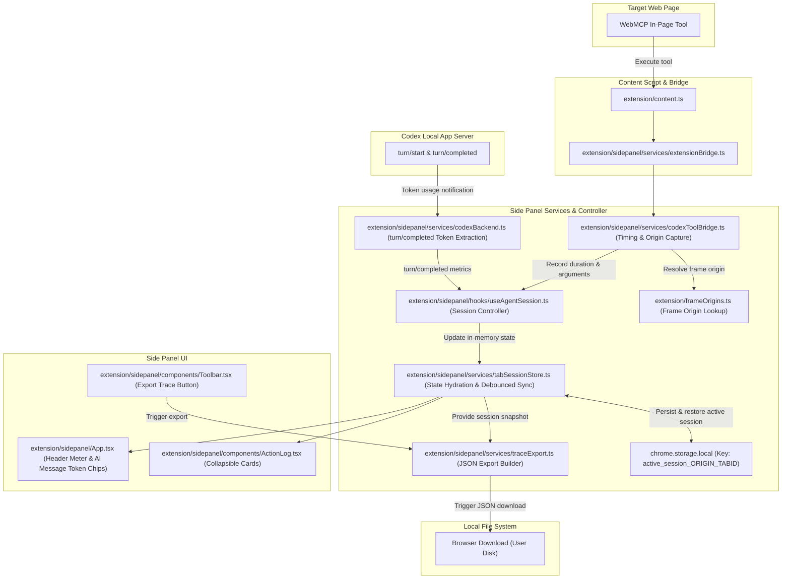

# WebMCP extension feature enhancements

- **Author:** Mike Kobit
- **Status:** Draft
- **Date:** 2026-11-10

---

## Overview

This document specifies developer workflow enhancements for the WebMCP Chrome side panel extension:
1. Persist the active conversation and tool state per domain across page refreshes and side panel reloads using `chrome.storage.local`.
2. Display collapsible tool execution provenance cards in the side panel drawer with execution duration and frame origin.
3. Track and render per-turn and cumulative session token usage from Codex server notifications.
4. Export session history, tool execution telemetry, and token metrics to a single JSON trace file for demonstrations and review.

The primary user is a website developer who tests and verifies in-page WebMCP tools against a target web application using a local Codex app-server.

---

## Problem statement

Developers test in-page WebMCP tools using the WebMCP extension with the local Codex app-server.
The current workflow introduces four operational gaps:
- Reloading the page or closing the side panel clears the chat and tool history, forcing developers to restart conversations during iterative debugging.
- Tool executions lack visible telemetry (duration, frame origin, raw inputs and outputs) in the side panel drawer, which requires opening browser DevTools consoles to inspect calls.
- Developers cannot observe model token consumption across turns.
- Developers cannot export conversation and tool execution traces to share with team members or inspect offline.

The proposed solution persists the active domain session in `chrome.storage.local`, renders execution provenance cards in the drawer, displays token usage counters, and provides a single-click JSON trace export.

---

## Goals

- Persist and restore active conversation messages and tool execution logs per domain origin in `chrome.storage.local`.
- Clear the saved active session upon explicit user action ("New session" button).
- Display tool execution state, tool identifier, execution duration in milliseconds, input parameters, and raw return payloads in collapsible cards.
- Display per-turn prompt and completion token counts and cumulative session totals from Codex `turn/completed` notifications.
- Export conversation history, tool definitions, tool execution telemetry, and token metrics into a single downloadable JSON trace file.

---

## Non-goals

- Capture, store, or display screenshots or image attachments in the extension (image capture is deferred to target applications such as `moergo-prototype`).
- Implement multi-session archives or historical session switching menus.
- Implement DOM element bounding box highlighting during tool runs.
- Provide a standalone tool execution console without model interaction.
- Mock tool responses or inject synthetic error payloads.

---

## Critical user journeys

### CUJ 1: Refresh target page without losing active conversation

- **Given**: A developer conducts a multi-turn conversation with tool executions on `http://localhost:3000`.
- **When**: The developer refreshes the web page or closes and reopens the side panel.
- **Then**: The extension restores the conversation messages, tool activity entries, and cumulative token metrics from `chrome.storage.local`.

### CUJ 2: Inspect tool execution provenance in drawer

- **Given**: The model executes an in-page tool on the target web application.
- **When**: The tool execution completes.
- **Then**: The side panel drawer displays a collapsible card with execution status and duration, expandable to reveal frame origin, parameters, and return payloads.

### CUJ 3: Export session trace for demonstration

- **Given**: A developer completes a series of tool tests and model interactions.
- **When**: The developer selects the export trace button in the side panel toolbar.
- **Then**: The extension downloads a structured JSON file containing the full transcript, tool definitions, execution durations, and token usage metrics.

---

## Proposed architecture

### Component architecture



### Detailed component specifications

#### 1. Tool execution provenance and telemetry
- **Data model updates ([`extension/sidepanel/types/index.ts`](../../extension/sidepanel/types/index.ts)):**
  - Extend `ActivityEntry`:
    ```typescript
    export interface ActivityEntry {
      id: number;
      name: string;
      done: boolean;
      status?: 'running' | 'success' | 'error';
      durationMs?: number;
      frameId?: number;
      frameOrigin?: string;
      arguments?: Record<string, unknown>;
      resultSummary?: string;
      rawResult?: unknown;
      errorMessage?: string;
    }
    ```
- **Frame origin lookup ([`extension/frameOrigins.ts`](../../extension/frameOrigins.ts)):**
  - Add helper `getFrameOrigin(tabId: number, frameId: number): Promise<string | undefined>` using `chrome.webNavigation.getFrame`.
- **Telemetry instrumentation and controller wiring:**
  - Update `ToolExecutionOptions` in [`extension/sidepanel/services/codexToolBridge.ts`](../../extension/sidepanel/services/codexToolBridge.ts) to accept `onToolTelemetry?: (entry: ActivityEntry) => void`.
  - In `handleCodexToolCall`, measure elapsed time using `performance.now()`.
  - Calculate `durationMs = Math.round(performance.now() - startTime)`.
  - Resolve frame origin via `getFrameOrigin(tabId, frameId)`.
  - Redact sensitive keys (`authorization`, `token`, `password`, `secret`) from input arguments and raw results.
  - Enforce a 64 KB payload size cap per tool execution to preserve UI responsiveness and storage bounds.
  - Invoke `onToolTelemetry` to record the entry.
  - In [`extension/sidepanel/hooks/useAgentSession.ts`](../../extension/sidepanel/hooks/useAgentSession.ts), pass `onToolTelemetry` into `handleCodexToolCall` and record activity updates in `runToolCall()`.
- **Drawer UI rendering ([`extension/sidepanel/components/ActionLog.tsx`](../../extension/sidepanel/components/ActionLog.tsx)):**
  - Replace flat text rows with collapsible card elements:
    - **Header (collapsed by default):** Status indicator (running spinner, success check, error icon), tool name, and duration badge (for example, `42ms`).
    - **Expanded details:**
      - Frame origin (indicates top-level page or iframe origin).
      - Input arguments formatted as indented JSON.
      - Return payload or error description.

#### 2. Active session persistence in `chrome.storage.local`
- **Manifest permission ([`extension/manifest.json`](../../extension/manifest.json)):**
  - Add `"storage"` to the `permissions` array.
- **Storage schema:**
  - Key format: `active_session_${origin}_${tabId}` to prevent multi-tab collisions on identical origins.
  - Data structure:
    ```typescript
    export interface PersistedSessionData {
      version: 1;
      origin: string;
      tabId: number;
      updatedAt: number;
      messages: ChatMessage[];
      activityLog: ActivityEntry[];
      tokenUsage?: TokenUsage;
      codexThreadId?: string;
    }
    ```
- **Hydration, retention, and synchronization ([`extension/sidepanel/services/tabSessionStore.ts`](../../extension/sidepanel/services/tabSessionStore.ts) and [`extension/sidepanel/hooks/useAgentSession.ts`](../../extension/sidepanel/hooks/useAgentSession.ts)):**
  - On tab switch or page navigation: read `active_session_${origin}_${tabId}` from `chrome.storage.local`.
  - Apply 24-hour retention expiration: if `updatedAt < Date.now() - 86_400_000`, discard the stored session and initialize fresh state.
  - If a valid saved session exists, hydrate `messages`, `activityLog`, `tokenUsage`, and `codexThreadId`.
  - Codex thread validation: if the Codex app-server returns a thread not found error, reset `codexThreadId` in state and request a new thread while preserving user-visible message history.
  - Debounce updates (500 ms) on message appends or tool activity changes before writing to `chrome.storage.local`.
  - Expose `flushActiveSession(tabId: number)` to immediately persist uncommitted changes.
  - Bind `flushActiveSession` to window `beforeunload` and React component unmount in `App.tsx` and `useAgentSession.ts` to prevent data loss on tab close or navigation.
  - Listen to `chrome.tabs.onRemoved` in the background service worker or store to clean up `active_session_${origin}_${tabId}` entries when a tab closes.
  - On explicit user reset ("New session" in `App.tsx` via `handleReset()` in `useAgentSession.ts`): delete `active_session_${origin}_${tabId}` from `chrome.storage.local` and reset in-memory state.

#### 3. Token usage tracking
- **Metrics extraction ([`extension/sidepanel/services/codexBackend.ts`](../../extension/sidepanel/services/codexBackend.ts)):**
  - Intercept `turn/completed` JSON-RPC notifications from the Codex app-server.
  - Extract the token usage payload:
    ```typescript
    export interface TokenUsage {
      promptTokens: number;
      completionTokens: number;
      totalTokens: number;
    }
    ```
  - Update `ChatTurnResponse` in [`extension/sidepanel/types/index.ts`](../../extension/sidepanel/types/index.ts) to include `tokenUsage?: TokenUsage`.
  - Update `CodexTurnCompletedNotification` in [`extension/sidepanel/types/codex.ts`](../../extension/sidepanel/types/codex.ts) to type `params.usage?: TokenUsage`.
- **State management ([`extension/sidepanel/hooks/useAgentSession.ts`](../../extension/sidepanel/hooks/useAgentSession.ts) and [`extension/sidepanel/services/tabSessionStore.ts`](../../extension/sidepanel/services/tabSessionStore.ts)):**
  - In `persistTurnOutput()`, attach per-turn `tokenUsage` to the generated `'ai'` `ChatMessage`.
  - Export `TabSessionState` from `tabSessionStore.ts` and aggregate running total `sessionTokenUsage: TokenUsage`.
- **UI indicators:**
  - [`extension/sidepanel/App.tsx`](../../extension/sidepanel/App.tsx): In `chat-card__messages`, render a compact chip below `'ai'` message entries displaying prompt and completion counts (for example, `320 prompt / 85 completion tokens`).
  - [`extension/sidepanel/App.tsx`](../../extension/sidepanel/App.tsx) and [`extension/sidepanel/components/ContextMeter.tsx`](../../extension/sidepanel/components/ContextMeter.tsx): Render cumulative session tokens directly adjacent to or inside the context meter in `chat-card__header`.

#### 4. Single-click JSON trace export
- **Export service ([`extension/sidepanel/services/traceExport.ts`](../../extension/sidepanel/services/traceExport.ts)):**
  - Define `SessionTraceExport` in [`extension/sidepanel/types/index.ts`](../../extension/sidepanel/types/index.ts):
    ```typescript
    export interface SessionTraceExport {
      version: 1;
      exportedAt: string;
      origin: string;
      sessionTokenUsage?: TokenUsage;
      messages: ChatMessage[];
      activityLog: ActivityEntry[];
      tools: WebMCPTool[];
    }
    ```
  - Define `exportSessionTrace(state: TabSessionState): void`.
  - Generate a Blob with `type: 'application/json'`.
  - Trigger download via an anchor element with file name `webmcp-trace-${sanitizedOrigin}-${Date.now()}.json`.
- **Toolbar trigger ([`extension/sidepanel/components/Toolbar.tsx`](../../extension/sidepanel/components/Toolbar.tsx)):**
  - Add `DownloadIcon` to [`extension/sidepanel/components/Icons.tsx`](../../extension/sidepanel/components/Icons.tsx).
  - Add `onExportTrace?: () => void` to `ToolbarProps`.
  - Add an export icon button to the composer toolbar.
  - Disable the button when the conversation contains zero messages.
- **Component styling ([`extension/sidepanel/styles.css`](../../extension/sidepanel/styles.css)):**
  - Add CSS classes for collapsible card layout, badges, token chips, and export button alignment.

---

## Alternatives considered

### Alternative A: IndexedDB storage engine for session persistence

- **Description**: Use browser IndexedDB to persist conversation turns, tool activity entries, and token usage records.
- **Pros**: Provides transaction support and handles large data volumes without serializing full session JSON trees.
- **Cons**: Adds database schema versioning, transaction error handling, and asynchronous cursor management for simple key-value records.
- **Reason for rejection**: `chrome.storage.local` provides direct key-value storage with lower runtime overhead and simpler state synchronization than an IndexedDB transaction lifecycle.

### Alternative B: Multi-session archive and history switcher (20-session LRU)

- **Description**: Implement an indexed multi-session manager that stores up to 20 past sessions per domain with an LRU eviction policy and header dropdown selector.
- **Pros**: Allows developers to switch between multiple older conversation threads on the same origin.
- **Cons**: Adds significant state management complexity, metadata indexing, eviction logic, and header UI controls.
- **Reason for rejection**: Persisting the active session per origin and tab satisfies prototype development workflows without the state management overhead of multi-session index tracking.

### Alternative C: Extension-driven screenshot and image artifact handling

- **Description**: Capture screenshots via `chrome.tabs.captureVisibleTab` or process in-page image payloads inside the extension with dedicated artifact storage.
- **Pros**: Enables visual inspection of website state inside the side panel.
- **Cons**: Significantly increases extension complexity, introduces large image storage management, and risks model context token inflation.
- **Reason for rejection**: Image capture responsibility is deferred to specialized web applications (such as `moergo-prototype`) to keep extension scope bounded and minimal.

### Alternative D: Rely solely on side panel drawer inspection without JSON trace export

- **Description**: Display tool provenance in `ActionLog.tsx` drawer without providing a downloadable JSON export file.
- **Pros**: Eliminates export serialization routines and toolbar buttons.
- **Cons**: Prevents developers from archiving test runs, comparing tool behavior across runs, or sharing reproducible execution traces with team members.
- **Reason for rejection**: Trace export requires minimal client-side code and enables offline analysis and collaborative bug reporting.

### Alternative E: Direct tool execution playground without model turns

- **Description**: Add an interactive UI panel to manually execute in-page WebMCP tools with arbitrary arguments without involving the Codex model.
- **Pros**: Allows quick manual testing of individual tool functions.
- **Cons**: Duplicates browser DevTools console functionality and does not test model-driven tool discovery, schema interpretation, or tool calling loops.
- **Reason for rejection**: Real-world validation requires testing in-page WebMCP tools through the full model-mediated agent workflow.

---

## Non-functional requirements

### Security and privacy
- Active session transcripts stored in `chrome.storage.local` reside entirely in the user's local Chrome profile and are never synced to remote servers.
- JSON trace exports are generated client-side using in-memory Blobs and downloaded directly through the browser without third-party network transmission.
- Tool input parameters and raw results displayed in `ActionLog.tsx` respect per-origin permission boundaries and apply client-side sensitive key redaction for passwords, tokens, and authorization headers.

### Performance and latency
- Storage writes to `chrome.storage.local` are debounced by 500 milliseconds to avoid disk I/O bottlenecks during rapid message streaming or consecutive tool executions.
- Unload and unmount handlers flush uncommitted state synchronously to prevent data loss.
- Tool execution timing via `performance.now()` introduces sub-millisecond overhead.
- Collapsible cards in `ActionLog.tsx` defer syntax formatting until expanded, preventing UI render lag in large logs.
- Tool payload recording enforces a 64 KB size limit to avoid UI thread blocking and storage quota exhaustion.

---

## Risks and mitigations

| Risk | Impact | Mitigation |
| --- | --- | --- |
| Storage quota saturation in `chrome.storage.local` | Writes fail with quota errors during extended testing | Limit tool arguments and outputs to 64 KB per execution. Expire stored sessions older than 24 hours. Clear data on "New session". |
| Multi-tab write collisions on identical origins | Tabs overwrite each other's session state | Scope storage keys by origin and tabId (`active_session_${origin}_${tabId}`). Add `chrome.tabs.onRemoved` cleanup. |
| Stale Codex thread ID after server restart | Prompt submissions fail with unhandled RPC errors | Detect thread not found errors on hydration. Reset `codexThreadId` and create a fresh thread while preserving visible chat messages. |
| Main thread freezing during trace serialization | Side panel UI stutters when generating large exports | Cap payload sizes, build JSON asynchronously via Blob constructors, and avoid blocking synchronous traversals. |

---

## Detailed implementation plan

### Phase 1: Core types, manifest permissions, and frame origin lookup

#### 1. [`extension/manifest.json`](../../extension/manifest.json) (Modify)
- **Scope**: Chrome extension manifest configuration.
- **Changes**: Add `"storage"` to the `permissions` array to grant access to `chrome.storage.local`.

#### 2. [`extension/sidepanel/types/index.ts`](../../extension/sidepanel/types/index.ts) (Modify)
- **Scope**: Common side panel TypeScript interfaces.
- **Changes**:
  - Extend `ActivityEntry` with optional telemetry fields: `status?: 'running' | 'success' | 'error'`, `durationMs?: number`, `frameId?: number`, `frameOrigin?: string`, `arguments?: Record<string, unknown>`, `resultSummary?: string`, `rawResult?: unknown`, and `errorMessage?: string`.
  - Define `TokenUsage`: `{ promptTokens: number; completionTokens: number; totalTokens: number }`.
  - Add `tokenUsage?: TokenUsage` to `ChatMessage` and `ChatTurnResponse`.
  - Define `SessionTraceExport` interface for trace serialization.

#### 3. [`extension/sidepanel/types/codex.ts`](../../extension/sidepanel/types/codex.ts) (Modify)
- **Scope**: Codex JSON-RPC notification types.
- **Changes**: Add `usage?: TokenUsage` to `CodexTurnCompletedNotification.params`.

#### 4. [`extension/frameOrigins.ts`](../../extension/frameOrigins.ts) (Modify)
- **Scope**: Frame origin helper utility.
- **Changes**: Implement `getFrameOrigin(tabId: number, frameId: number): Promise<string | undefined>` using `chrome.webNavigation.getFrame`.

**Phase 1 verification checkpoint:**
- Run `npm run typecheck` to verify interface integrity across all packages.

---

### Phase 2: Telemetry instrumentation and backend token extraction

#### 5. [`extension/sidepanel/services/codexToolBridge.ts`](../../extension/sidepanel/services/codexToolBridge.ts) (Modify)
- **Scope**: Tool execution bridge for Codex.
- **Changes**:
  - Extend `ToolExecutionOptions` with `onToolTelemetry?: (entry: ActivityEntry) => void`.
  - Measure execution elapsed time with `performance.now()`.
  - Calculate `durationMs = Math.round(performance.now() - startTime)`.
  - Query frame origin via `getFrameOrigin(tabId, frameId)`.
  - Apply 64 KB payload truncation and sensitive key redaction.
  - Forward populated `ActivityEntry` via `onToolTelemetry`.

#### 6. [`extension/sidepanel/services/codexBackend.ts`](../../extension/sidepanel/services/codexBackend.ts) (Modify)
- **Scope**: Codex JSON-RPC backend service.
- **Changes**:
  - Intercept `turn/completed` JSON-RPC notification in `ensureClientHandlers`.
  - Extract `params.usage` (`promptTokens`, `completionTokens`, `totalTokens`).
  - Attach `tokenUsage` to the turn resolution payload.

#### 7. [`extension/sidepanel/hooks/useAgentSession.ts`](../../extension/sidepanel/hooks/useAgentSession.ts) (Modify)
- **Scope**: Primary agent session controller hook.
- **Changes**:
  - Wire `onToolTelemetry` into `handleCodexToolCall` to log telemetry entries.
  - Record execution duration, frame origin, and parameters in `runToolCall()`.
  - In `persistTurnOutput()`, attach `turnResponse.tokenUsage` to the generated `'ai'` `ChatMessage`.

**Phase 2 verification checkpoint:**
- Run `node scripts/test.ts unit` to confirm backend and tool bridge tests pass.

---

### Phase 3: Session persistence, store integration, and test harness

#### 8. [`extension/sidepanel/services/tabSessionStore.ts`](../../extension/sidepanel/services/tabSessionStore.ts) (Modify)
- **Scope**: Tab session state store and storage bridge.
- **Changes**:
  - Export `TabSessionState` interface.
  - Add `sessionTokenUsage?: TokenUsage` to `TabSessionState`.
  - Implement `saveActiveSession(tabId: number, origin: string)` with 500 ms debounce to write state to `active_session_${origin}_${tabId}`.
  - Implement `flushActiveSession(tabId: number)` for immediate storage writes on tab unload.
  - Implement `restoreActiveSession(tabId: number, origin: string)` to hydrate state from `chrome.storage.local`, enforcing 24-hour expiration.
  - Implement `clearActiveSession(tabId: number, origin: string)` to delete the stored key on session reset.

#### 9. [`extension/sidepanel/hooks/useAgentSession.ts`](../../extension/sidepanel/hooks/useAgentSession.ts) (Modify - Part 2)
- **Scope**: Session lifecycle management.
- **Changes**:
  - In `handleReset()`, trigger `clearActiveSession()` to purge saved storage.
  - Bind `flushActiveSession` to component unmount and `beforeunload`.
  - Add Codex thread recovery: reset `codexThreadId` on thread validation errors.

#### 10. [`tests/extension/tabSessions.test.ts`](../../tests/extension/tabSessions.test.ts) (Modify)
- **Scope**: Tab session unit test suite.
- **Changes**:
  - Extend `installTestChrome()` with an in-memory `chrome.storage.local` mock (`get`, `set`, `remove`, `clear`).
  - Add test: `saveActiveSession` writes debounced state to `chrome.storage.local`.
  - Add test: `restoreActiveSession` populates messages, token totals, and telemetry.
  - Add test: `restoreActiveSession` discards entries older than 24 hours.
  - Add test: `clearActiveSession` removes the stored session key.
  - Add test: `flushActiveSession` writes uncommitted changes immediately.

**Phase 3 verification checkpoint:**
- Run `npm test` to verify tab session persistence and mock execution.

---

### Phase 4: UI components, styling, and trace export utility

#### 11. [`extension/sidepanel/components/Icons.tsx`](../../extension/sidepanel/components/Icons.tsx) (Modify)
- **Scope**: SVG icon collection.
- **Changes**: Add `DownloadIcon` component.

#### 12. [`extension/sidepanel/components/Toolbar.tsx`](../../extension/sidepanel/components/Toolbar.tsx) (Modify)
- **Scope**: Composer toolbar controls.
- **Changes**:
  - Add `onExportTrace?: () => void` to `ToolbarProps`.
  - Render export icon button with `DownloadIcon`.
  - Disable export button when session message list is empty.

#### 13. [`extension/sidepanel/components/ActionLog.tsx`](../../extension/sidepanel/components/ActionLog.tsx) (Modify)
- **Scope**: Tool activity drawer view.
- **Changes**:
  - Replace flat rows with collapsible cards.
  - Render header with tool name, status indicator, and duration badge.
  - Render expandable section with frame origin, formatted arguments, and raw results.

#### 14. [`extension/sidepanel/App.tsx`](../../extension/sidepanel/App.tsx) (Modify)
- **Scope**: Root side panel React view.
- **Changes**:
  - In `chat-card__messages`, render token usage chip below `'ai'` message bubbles.
  - In `chat-card__header`, display cumulative session tokens adjacent to `ContextMeter.tsx`.
  - Wire `onExportTrace` to invoke `exportSessionTrace`.
  - Bind unmount and `beforeunload` to flush storage.

#### 15. [`extension/sidepanel/services/traceExport.ts`](../../extension/sidepanel/services/traceExport.ts) (Create)
- **Scope**: Client-side JSON trace generation utility.
- **Changes**:
  - Implement `exportSessionTrace(state: TabSessionState): void`.
  - Assemble `SessionTraceExport` payload.
  - Serialize to Blob and initiate download with filename `webmcp-trace-${sanitizedOrigin}-${Date.now()}.json`.

#### 16. [`extension/sidepanel/styles.css`](../../extension/sidepanel/styles.css) (Modify)
- **Scope**: Extension styling.
- **Changes**: Add styles for collapsible cards, duration badges, token chips, and export button alignment.

#### 17. [`tests/extension/traceExport.test.ts`](../../tests/extension/traceExport.test.ts) (Create)
- **Scope**: Trace export utility unit tests.
- **Changes**: Verify JSON structure, message retention, telemetry capture, and filename generation.

**Phase 4 verification checkpoint:**
- Run `npm run typecheck && npm test && npm run build` to verify full compilation and bundle output.

---

## Verification plan

### Automated verification

- **TypeScript type checking**:
  `npm run typecheck`
  Verifies that all interface additions, component props, and Node scripts pass strict type validation.
- **Unit tests**:
  `npm test`
  Executes all unit tests with Node's native test runner (`node:test`) via `scripts/test.ts`, including tests in `tabSessions.test.ts`, `codexToolBridge.test.ts`, `codexBackend.test.ts`, and `traceExport.test.ts`.
- **Extension production build**:
  `npm run build`
  Compiles the extension bundle via `scripts/build.ts` using `esbuild`, confirming bundle output without syntax or path errors.

### Manual verification

1. **Session persistence**:
   - Open side panel on `http://localhost:3000`.
   - Send a prompt and execute an in-page tool.
   - Refresh the target tab. Verify that conversation messages and tool entries remain displayed.
   - Click "New session". Verify that the session clears and does not reappear on page refresh.
2. **Tool provenance drawer**:
   - Trigger an in-page tool call.
   - Confirm that the tool entry in `ActionLog.tsx` displays execution time in milliseconds and a status indicator.
   - Expand the card and verify that frame origin, input arguments, and return payload render without truncation errors.
3. **Token usage indicators**:
   - Verify that `'ai'` messages display a token chip with prompt and completion counts.
   - Verify that the header displays cumulative tokens for the active session.
4. **Trace export**:
   - Click the export button in the toolbar.
   - Verify that a JSON file downloads with filename pattern `webmcp-trace-localhost-3000-<timestamp>.json`.
   - Open the JSON file and verify that messages, tool definitions, execution telemetry, and token metrics match the active session.
