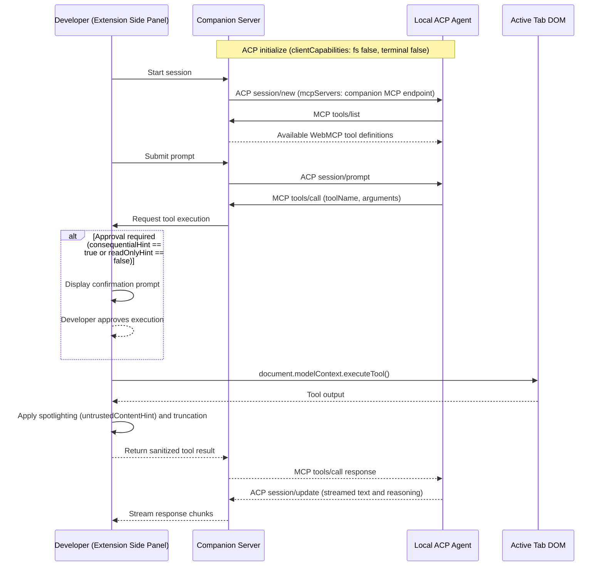

# Feature request: Agent Client Protocol (ACP) backend and in-process MCP server for companion server

### What are you trying to do?

The WebMCP extension lets developers test WebMCP tools that web pages expose on `document.modelContext`. Currently, the extension routes chat turns either to the browser built-in Prompt API or to cloud model providers through the companion server.

This design introduces two limitations:
1. Developers must configure raw model API keys in environment files instead of using their existing local agent environments.
2. The extension cannot interface with local agent runtimes that communicate through the Agent Client Protocol (ACP), such as Google Antigravity (`agy acp`) or OpenAI Codex (`codex-acp`).

Developers also cannot use ACP `configOptions` to discover available models and reasoning levels without managing raw API keys.

### What would you like to see?

Add an ACP client backend and an in-process Model Context Protocol (MCP) server to the companion server.

The proposed architecture includes:
- **Agent Client Protocol connection**: Connect the companion server to local agent runtimes over UNIX domain sockets, named pipes, or TCP loopback.
- **Capability restrictions**: Advertise `clientCapabilities: { fs: { readTextFile: false, writeTextFile: false }, terminal: false }` during ACP initialization to prevent host filesystem access or terminal command execution.
- **Model discovery**: Use ACP `configOptions` to discover available models and reasoning levels directly from the agent runtime without managing raw API keys.
- **Session configuration**: Pass `mcpServers` during `session/new` so the agent runtime can discover and call available MCP tools.
- **In-process Model Context Protocol server**: Expose an MCP endpoint on the companion server that maps WebMCP tools from the active browser tab into MCP tool definitions.
- **Tool execution delegation**: Forward MCP `tools/call` requests from the companion server to the extension side panel. The extension side panel evaluates permissions, prompts the user when required, executes `document.modelContext.executeTool()` in the active tab context, applies guardrails, and returns the result through the companion server to complete the MCP tool call.

#### Protocol interaction flow

### Security considerations

- **Host capability restrictions**: The companion server advertises `clientCapabilities: { fs: { readTextFile: false, writeTextFile: false }, terminal: false }` during ACP initialization. The server rejects any agent requests to read files, write files, or execute terminal commands on the host.
- **Human-in-the-loop approval**: The extension side panel gates tool execution. Tools with `consequentialHint: true` or without `readOnlyHint` require explicit developer approval before execution in the active tab.
- **Untrusted content handling**: Output from `document.modelContext.executeTool()` is treated as untrusted data. The extension side panel applies spotlighting for tools marked with `untrustedContentHint` and enforces character truncation limits before returning results to the agent.
- **Process isolation**: The companion server connects to external agent sockets rather than managing agent process lifecycles.
