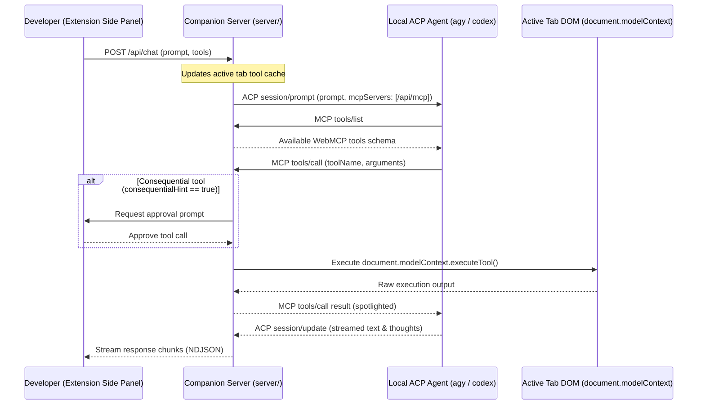

# Feature request: Agent Client Protocol (ACP) backend and in-process MCP server for companion server

## Problem description

The WebMCP extension enables developers to test WebMCP tools exposed by web pages on `document.modelContext`.
Currently, the extension routes chat turns either to the browser's built-in Prompt API or to LLM API providers through the Node.js companion server (`server/`).

This design creates two limitations for developer workflows:
1. Developers must configure raw model provider API keys in `.env` files rather than leveraging their existing local agent environments.
2. The extension cannot interface with local agent CLI runtimes that communicate via the Agent Client Protocol (ACP), such as Google Antigravity (`agy acp`) or OpenAI Codex (`codex-acp`).

## Proposed enhancement

Extend the companion server (`server/`) with:
1. An **ACP client module**: Connects to external local agent runtimes over UNIX domain sockets, named pipes, or TCP loopback.
2. An **in-process MCP server**: Exposes an HTTP/SSE Model Context Protocol endpoint at `/api/mcp` that translates `document.modelContext` tools from the active browser tab into MCP tool definitions.
3. A **stdio relay script (`server/mcp-relay.js`)**: Bridges stdio JSON-RPC streams to `http://127.0.0.1:3000/api/mcp` for agent runtimes that do not support HTTP MCP endpoints natively.
4. **Security guardrails**: Advertises `clientCapabilities: { fs: false, terminal: false }` during ACP initialization and rejects any host filesystem or terminal command execution requests. Consequential tools (`consequentialHint: true`) require explicit developer approval in the extension side panel.

## Protocol interaction flow

## Security considerations

- **Zero host capability exposure**: Web content must never be able to trigger host command execution or file access. The ACP client enforces `fs: false` and `terminal: false`.
- **Human in the loop**: Tools annotated with `consequentialHint: true` defer execution until the developer explicitly approves the prompt in the side panel.
- **Spotlighting**: Outputs returned from untrusted web pages undergo base64 encoding or fencing and 8,000 character limits before being supplied to the model.

## Alternatives evaluated

- **Direct WebSocket connection from extension side panel**: Tested in prototype branch. Rejected because it bypasses companion server logging, requires `declarativeNetRequest` rules to strip HTTP `Origin` headers, and binds the extension to proprietary JSON-RPC formats instead of standard ACP/MCP.
- **Spawning agent CLI child processes inside companion server**: Rejected to prevent orphan process leaks and brittle signal handling. Connecting to externally running sockets maintains clear process isolation.
